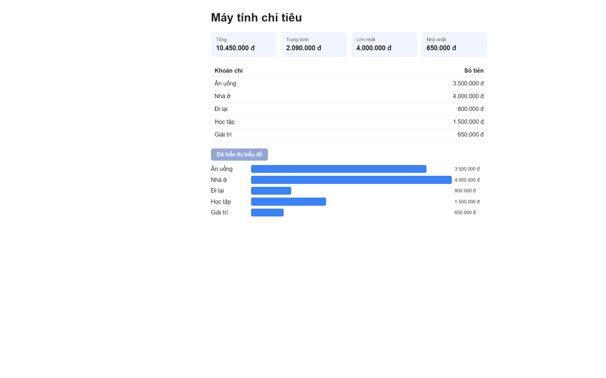
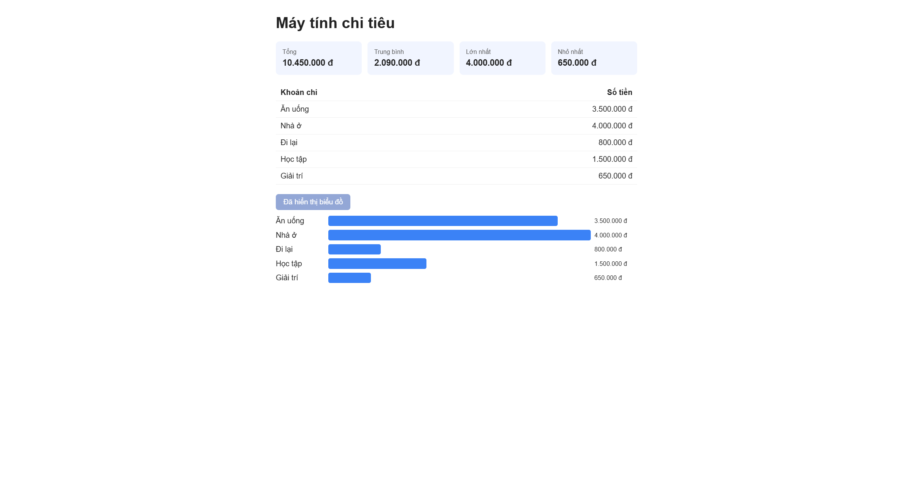

# Lab 8 — Công cụ & Triển khai

Ứng dụng: "Máy tính chi tiêu" của lab7, copy vào `src/` (file chính `main.js` đổi tên thành `src/index.js`).

## Cấu trúc thư mục

```
lab8/
  package.json
  webpack.config.js
  eslint.config.mjs
  src/
    index.html          (template, không có thẻ <script>)
    index.js            (entry)
    modules/
      tinhToan.js
      dinhDang.js
      bieuDo.js         (dynamic import)
  dist/                 (sinh ra khi build)
    index.html
    bundle.js
    bieuDo.[hash].js
```

## 1. Khởi tạo npm và cài công cụ

```
npm init -y
npm install --save-dev webpack webpack-cli webpack-dev-server html-webpack-plugin eslint @eslint/js globals
```

Log:

```
Wrote to C:\Users\Vinh\OneDrive\Desktop\labjsfpoly\lab8\package.json
...
added 381 packages, and audited 382 packages in 20s
```

`webpack-dev-server` được cài để chạy lệnh `dev`. `@eslint/js` và `globals` dùng trong file cấu hình ESLint. Tất cả nằm trong `devDependencies` vì chỉ cần khi phát triển và build, sản phẩm chạy trên trình duyệt không cần chúng.

Lưu ý: `npm init -y` bản mới tự thêm `"type": "commonjs"` vào `package.json`. Lần build đầu bị lỗi vì dòng này:

```
ERROR in ./src/index.js 1:0
Module parse failed: 'import' and 'export' may appear only with 'sourceType: module' (1:0)
```

Cách sửa: xóa dòng `"type": "commonjs"`, để webpack tự nhận diện `import`/`export` trong `src/`.

## 2. Cấu hình Webpack

`webpack.config.js`: entry `./src/index.js`, output `dist/bundle.js`, dùng `HtmlWebpackPlugin` với template `src/index.html`. `clean: true` để xóa `dist/` cũ trước mỗi lần build.

## 3. ESLint

Cấu hình `eslint.config.mjs`: dùng bộ luật `recommended`, môi trường trình duyệt, và bật thêm `eqeqeq` (bắt dùng `===`), `no-unused-vars`, `no-undef`, `prefer-const`.

```
npx eslint src/
```

Kết quả: không có lỗi, không có cảnh báo (exit code 0).

Để chắc chắn ESLint thật sự hoạt động, mình tạo thử một file có lỗi cố ý:

```js
let bienThua = 1;
if (window.x == 1) {
    chuaKhaiBao = 2;
}
```

ESLint báo đủ 4 lỗi:

```
1:5   error  'bienThua' is assigned a value but never used        no-unused-vars
1:5   error  'bienThua' is never reassigned. Use 'const' instead  prefer-const
2:14  error  Expected '===' and instead saw '=='                  eqeqeq
3:5   error  'chuaKhaiBao' is not defined                         no-undef
✖ 4 problems (4 errors, 0 warnings)
```

Sau đó xóa file thử, chạy lại `npx eslint src/` thì sạch.

## 4. Script trong package.json

```json
"scripts": {
  "dev": "webpack serve --mode development",
  "build": "webpack --mode production",
  "lint": "eslint src/"
}
```

## 5. Build production

```
npm run build
```

Log:

```
asset bundle.js 3.73 KiB [emitted] [minimized] (name: main)
asset index.html 1.69 KiB [compared for emit] [minimized]
asset bieuDo.305b362183deac80a77d.js 726 bytes [emitted] [immutable] [minimized] (name: bieuDo)
...
webpack 5.111.1 compiled successfully in 832 ms
```

- `bundle.js` và `index.html` đều có nhãn `[minimized]`, tức là đã được rút gọn.
- Module `bieuDo.js` được webpack tách thành file riêng `bieuDo.[hash].js`, vì nó được nạp bằng dynamic import. Tên chunk được đặt bằng comment `/* webpackChunkName: "bieuDo" */`.

Đoạn đầu `dist/bundle.js`, code dồn thành một dòng, tên biến rút ngắn, không còn khoảng trắng và comment:

```
(()=>{"use strict";var t={793(t,e,n){function o(t){return Math.round(t).toLocaleString("vi-VN")+" đ"}n.d(e,{A:()=>o})}};const e={};function n(o){...
```

`dist/index.html` đã được HtmlWebpackPlugin tự chèn thẻ script trỏ đúng bundle:

```html
<script defer src=bundle.js></script>
```

Kiểm tra chạy thử bản build qua máy chủ tĩnh: log máy chủ cho thấy mở trang chỉ tải `index.html` và `bundle.js`. Khi bấm "Xem biểu đồ" thì mới tải `bieuDo.305b362183deac80a77d.js`:

```
14:51:21  "GET /lab8/dist/index.html"
14:51:21  "GET /lab8/dist/bundle.js"
14:51:29  "GET /lab8/dist/bieuDo.305b362183deac80a77d.js"
```

Ảnh bản build chạy ở máy: `screenshots/build-chay-local.png`



## 6. Deploy

Cách deploy: GitHub Pages. Đẩy code (gồm cả thư mục `dist/` đã build) lên repo https://github.com/cudaim23-wq/labjsfpoly, rồi bật GitHub Pages cho nhánh `main`:

```
gh repo create labjsfpoly --public --source . --remote origin --push
gh api -X POST repos/cudaim23-wq/labjsfpoly/pages -f "source[branch]=main" -f "source[path]=/"
```

Kiểm tra sau khi GitHub build xong:

```
status=built
https://cudaim23-wq.github.io/labjsfpoly/lab8/dist/index.html -> HTTP 200
https://cudaim23-wq.github.io/labjsfpoly/lab8/dist/bundle.js  -> HTTP 200, 3815 bytes
```

Link truy cập: **https://cudaim23-wq.github.io/labjsfpoly/lab8/dist/**

Ảnh trang đang chạy trên link (đã bấm "Xem biểu đồ"):



---

# Phần đọc-hiểu

## (1) Ba khác biệt giữa build development và production

1. **Rút gọn code (minify):** production nén code, bỏ khoảng trắng và comment, đổi tên biến cục bộ thành tên ngắn, nên file nhỏ và tải nhanh hơn. Development giữ code dễ đọc để lập trình viên xem được.
2. **Source map để gỡ lỗi:** development mặc định tạo source map (`eval`), nên khi có lỗi, DevTools chỉ đúng dòng trong file gốc như `src/modules/tinhToan.js`. Production mặc định không tạo source map, nên lỗi chỉ trỏ vào `bundle.js` đã nén, rất khó đọc.
3. **Mức độ tối ưu:** production bật các tối ưu như tree shaking (bỏ code được export nhưng không ai dùng), gộp module (scope hoisting), và đặt `process.env.NODE_ENV = "production"`. Development bỏ qua các bước này để build nhanh, phù hợp khi sửa code liên tục.

## (2) HtmlWebpackPlugin giải quyết vấn đề gì?

HtmlWebpackPlugin **tự sinh file HTML trong `dist/` và tự chèn thẻ `<script>` trỏ đúng tới các file bundle** sau mỗi lần build.

Nếu không có nó, mỗi lần build ta phải làm thủ công:

- Tự viết hoặc copy file `index.html` vào `dist/`.
- Tự thêm hoặc sửa thẻ `<script src="...">` cho đúng tên file bundle. Việc này rất dễ sai khi tên file có hash (ví dụ `bundle.a1b2c3.js`), vì hash đổi mỗi lần code thay đổi.
- Nếu thêm entry hoặc tách chunk thì lại phải nhớ thêm thẻ script tương ứng.

Plugin còn rút gọn luôn file HTML ở chế độ production.
